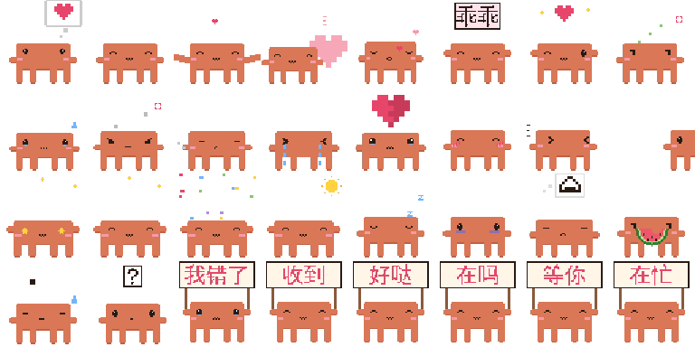

# Pixel Crab Stickers · 像素小螃蟹表情包



> **Unofficial fan work.** This is a fan-made tribute and is **not** affiliated with, endorsed by, or sponsored by Anthropic. "Claude" and related marks belong to Anthropic. No official artwork, logos, or assets are used.
>
> **非官方粉丝二创。**本项目是粉丝自制的致敬作品，与 Anthropic **无任何关联**，也未获其认可或赞助。"Claude" 及相关标识归 Anthropic 所有。项目不含任何官方原图、logo 或素材。

49 animated pixel-crab stickers about everyday couple life — missing you, hugs, bubble tea, bath time, holding up little signs — as transparent GIFs (288×288). There's a light-background set and a dark-background set, plus the script that draws them.

49 张会动的像素小螃蟹「情侣日常」表情，有想你、抱抱、喝奶茶、洗澡、举小牌子等等。都是透明 GIF（288×288），分浅色底和深色底两套，附带生成它们的脚本。

## Get them · 怎么拿

- **Browse & long-press to save:** <https://caleb-freya.github.io/pixel-crab-stickers/>
- **Download all (zip):** [light set](https://github.com/Caleb-Freya/pixel-crab-stickers/releases/latest/download/pixel-crab-stickers-light.zip) · [dark set](https://github.com/Caleb-Freya/pixel-crab-stickers/releases/latest/download/pixel-crab-stickers-dark.zip)

- **在线挑、长按保存/转发：**<https://caleb-freya.github.io/pixel-crab-stickers/>
- **一次下载全部（压缩包）：**[浅色版](https://github.com/Caleb-Freya/pixel-crab-stickers/releases/latest/download/pixel-crab-stickers-light.zip) · [深色版](https://github.com/Caleb-Freya/pixel-crab-stickers/releases/latest/download/pixel-crab-stickers-dark.zip)

WeChat / QQ have no bulk import: send a sticker to a chat, long-press it, then "Add to Stickers". 微信/QQ 没有整套导入：把图发进聊天，长按 →「添加到表情」即可。

## Stickers · 表情列表

| 中文 | English | 中文 | English |
|---|---|---|---|
| 想你 | miss you | 贴贴 | cheek squish |
| 抱抱 | hug | 蹭蹭 | nuzzle |
| 亲亲 | kiss | 哄你（乖乖） | there, there |
| 比心 | heart | 爱你（举牌） | love you (sign) |
| 吃醋 | jealous | 委屈 | aggrieved |
| 生气 | angry | 哼 | hmph |
| 哭 | crying | 心碎 | heartbroken |
| 害羞 | shy | 捂眼睛 | can't look |
| 偷看 | peek | 开心 | happy |
| 撒花 | confetti | 早安 | good morning |
| 晚安 | good night | 熬夜 | up all night |
| 饿饿 | hungry | 好吃 | yummy |
| 吃瓜 | eating melon (watching the drama) | 喝奶茶 | bubble tea |
| 无语 | speechless | 疑问 | confused |
| 送你花 | flower for you | 转圈圈 | spin |
| 打滚 | roll | 打电话 | phone call |
| 撑伞 | umbrella | 生日快乐 | happy birthday |
| 躺平 | melt | 跳舞 | dance |
| 冲呀 | charge | 洗澡 | bath time |
| 许愿 | make a wish | 求抱抱 | pick me up |
| 加油 | cheer | 发呆 | daydream |
| 我错了（举牌） | I'm sorry (sign) | 收到（举牌） | got it (sign) |
| 好哒（举牌） | okay (sign) | 在吗（举牌） | you there? (sign) |
| 等你（举牌） | waiting for you (sign) | 在忙（举牌） | busy (sign) |
| 陪我（举牌） | stay with me (sign) | | |

Light-background set: `out/`; dark-background set: `out-dark/`. `stickers.json` maps each Chinese name to an English slug.

浅色底在 `out/`，深色底在 `out-dark/`；`stickers.json` 是中文名和英文名的对照表。

## Make your own · 自己生成

Requirements: Python 3.9+ and Pillow (`pip install -r requirements.txt`). Text on the signs uses the WenQuanYi Zen Hei font (`fonts-wqy-zenhei` on Debian/Ubuntu); change `FONT` in `src/love.py` if yours lives elsewhere.

需要 Python 3.9 以上和 Pillow（`pip install -r requirements.txt`）。举牌上的字用文泉驿正黑（Debian/Ubuntu 装 `fonts-wqy-zenhei`）；字体在别的路径的话，改 `src/love.py` 里的 `FONT`。

```bash
cd src
python love.py              # all stickers → ../out/       生成全部（浅色）
python love.py --dark       # dark set → ../out-dark/      深色版
python love.py 想你 晚安     # just these                   只生成这几张
```

How it works: everything is drawn on a coarse cell grid, one cell = one big pixel. `src/kit.py` has the shared pieces (the crab body, faces, arms, squash & stretch, shadows, GIF export). `src/love.py` has one function per sticker that returns a list of `(frame, milliseconds)`. To add a sticker, write one more function and add its name to `NAMES`.

原理：所有东西都画在粗格子上，一格就是一个大像素。`src/kit.py` 放公用的部分：螃蟹身子、表情、手、压扁拉长、影子、导出 GIF。`src/love.py` 里每个表情是一个函数，返回 `(帧, 毫秒)` 列表。想加表情，就再写一个函数，并把名字加进 `NAMES`。

## Credits · 致谢

The crab's look and the drawing kit (`src/kit.py`) are adapted, under the MIT license, from [alwinecor/clawd-stickers](https://github.com/alwinecor/clawd-stickers), which in turn adapts parts of [Qisi3344/clawd-moji](https://github.com/Qisi3344/clawd-moji). Their license is kept in [LICENSE-THIRD-PARTY.md](LICENSE-THIRD-PARTY.md). The 49 stickers themselves — their stories, props and signs — are new. Thank you both!

螃蟹的样子和画图工具（`src/kit.py`）按 MIT 授权改编自 [alwinecor/clawd-stickers](https://github.com/alwinecor/clawd-stickers)，它又改编了 [Qisi3344/clawd-moji](https://github.com/Qisi3344/clawd-moji) 的部分代码。原授权保留在 [LICENSE-THIRD-PARTY.md](LICENSE-THIRD-PARTY.md)。这 49 张表情的小剧情、道具和牌子是新画的。谢谢两位作者！

## License · 授权

- **Code** (`src/`): [MIT](LICENSE). `src/kit.py` also carries the upstream MIT notice ([LICENSE-THIRD-PARTY.md](LICENSE-THIRD-PARTY.md)).
- **Artwork** (`out/*.gif`, `out-dark/*.gif`, `preview.gif`): [CC BY-NC 4.0](LICENSE-ART.md). Free for personal, non-commercial use with attribution. Because this is fan art of a character whose marks belong to someone else, **please don't use it commercially**, and don't present it as official.

- **代码**（`src/`）：[MIT](LICENSE)。`src/kit.py` 同时保留上游的 MIT 声明（[LICENSE-THIRD-PARTY.md](LICENSE-THIRD-PARTY.md)）。
- **图片**（`out/*.gif`、`out-dark/*.gif`、`preview.gif`）：[CC BY-NC 4.0](LICENSE-ART.md)，个人非商用免费使用，注明出处即可。这是粉丝二创，角色相关标识属于他人，所以**请勿商用**，也不要当成官方作品传播。

If you are a rights holder and would like anything changed or removed, please open an issue and it will be handled promptly.

如果你是相关权利人，希望修改或下架任何内容，请提 issue，会尽快处理。
